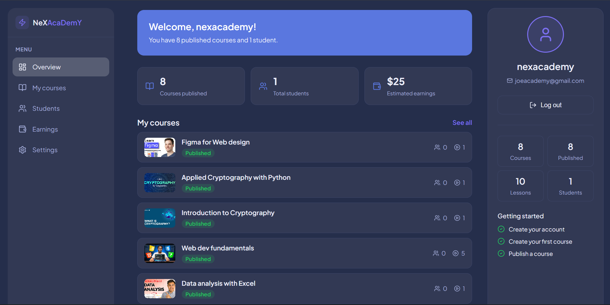
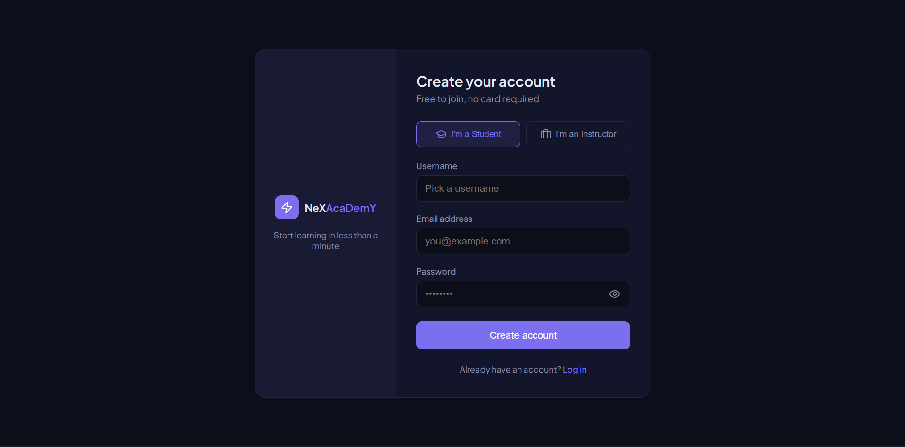
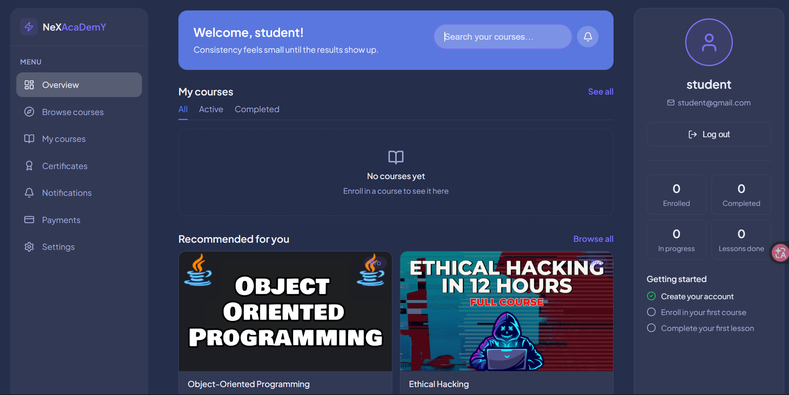
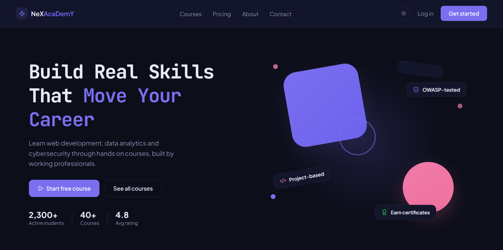

# NeXAcaDemY

NeXAcaDemY is a full-stack e-learning platform and database management system  built as a final-year project. It lets students browse and enroll in courses, track lesson progress, and subscribe to a Free/Pro plan, while instructors manage their own courses and admins manage users, courses, and security activity across the platform.

## Screenshots

| Instructor Dashboard | Student/Instructor Login | Student Dashboard |
|---|---|---|
|  |  |  |

| Home | 
|---|
|  |


## Features

- **Student experience:** browse courses, enroll, track per-lesson progress, free-preview lessons, Free/Pro subscription tiers
- **Instructor tools:** create and manage courses and lessons (ownership-checked server-side)
- **Admin dashboard:** suspend/reinstate users, remove any course, view a live security-log feed, read and action contact messages
- **Authentication:** email/password with bcrypt hashing, email verification, forgot/reset password flow, Google Sign-In, account lockout after repeated failed logins, session-expiry handling
- **Security logging:** every sensitive action (logins, lockouts, access-denied events, course edits/deletes, email/password changes) is written to a `security_logs` table
- **OWASP-aligned hardening:** built with a deliberate before/after security story — flaws identified and patched using OWASP ZAP

## Tech Stack

| Layer | Technology |
|---|---|
| Frontend | React 19 (Vite), JavaScript, plain CSS, React Router |
| Backend | PHP 8 (PDO, prepared statements throughout) |
| Database | MySQL / MariaDB |
| Auth | bcrypt hashing, Google Sign-In, PHPMailer (SMTP) |
| Architecture | Decoupled two-tier — React frontend ↔ PHP REST API over fetch/JSON |

## Database schema (overview)

- `users` — accounts, roles (student / instructor / admin), verification & lockout state
- `courses` — owned by an instructor, tagged `access_tier` (free / pro)
- `lessons` — belong to a course, flagged `is_preview` for free access
- `enrollments` — student ↔ course, with progress percentage
- `lesson_progress` — per-lesson completion tracking
- `subscriptions` — Free/Pro plan state per user
- `security_logs` — audit trail of auth and access events
- `contact_messages` — inbound messages handled from the admin dashboard

## Security highlights

- Role-based access control, enforced server-side (not just hidden in the UI)
- Bcrypt password hashing and PDO prepared statements everywhere — no raw concatenated SQL
- Enumeration-safe login (same error for a bad email vs. a bad password)
- Account lockout after repeated failed attempts, with server-side timing, not just a UI message
- Server-side paywall — locked/pro lesson content is withheld at the API level, not just hidden in the browser
- Least-privilege database access — the app connects with a scoped MySQL user with only the permissions it needs, not root
- Security event logging across sensitive actions for traceability

## Running it locally (XAMPP + Node)

1. **Install [XAMPP](https://www.apachefriends.org/)** and start **Apache** and **MySQL**.
2. **Clone the repo:**
   ```bash
   git clone https://github.com/charles-xv/nexacademy.git
   ```
3. **Backend (PHP API):**
   - Move/copy the `api` folder into `C:\xampp\htdocs\`
   - Create a database named `nexacademy` in phpMyAdmin and import the project's `.sql` file
   - Set your database connection to your local MySQL (a scoped user, not root) and database name `nexacademy`
   - Create your own local mail config (e.g. `config/mail.php`, gitignored) with a fresh Gmail App Password for PHPMailer — never reuse a previously shared credential
4. **Frontend (React/Vite):**
   ```bash
   cd nexacademy-frontend
   npm install
   npm run dev
   ```
   Starts the dev server, typically at `http://localhost:5173`.
5. **Point the frontend at your local API** — set the API base URL in the frontend source to your local API path (e.g. `http://localhost/api`).
6. Visit `http://localhost:5173` in your browser.

## Project structure

```
nexacademy/
├── nexacademy-frontend/   # React (Vite) app
│   └── src/
│       ├── pages/
│       ├── components/
│       └── data/
└── api/                   # PHP backend (REST endpoints, auth, admin)
```

## Author

Charles Nnanna — [GitHub](https://github.com/charles-xv) · [LinkedIn](https://linkedin.com/in/charles-nnanna-666ba1252)